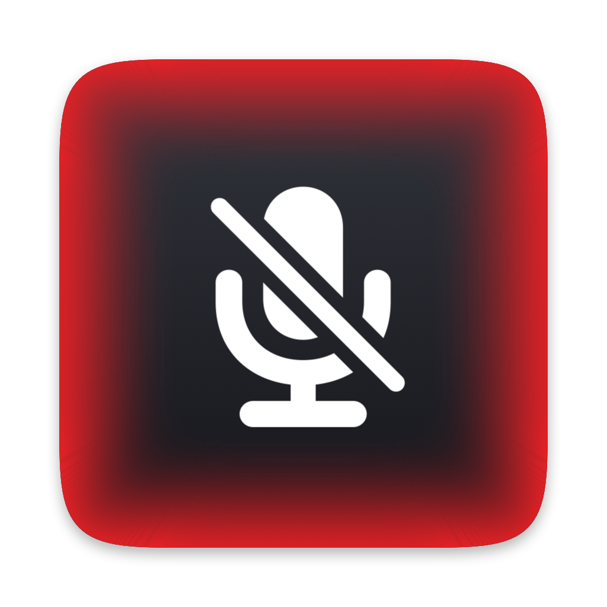
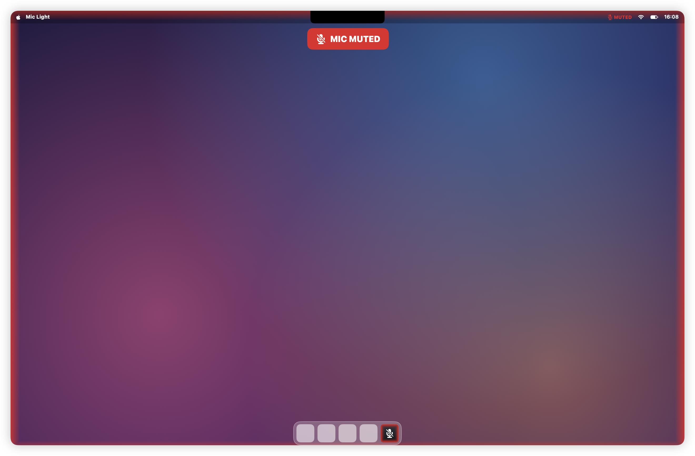
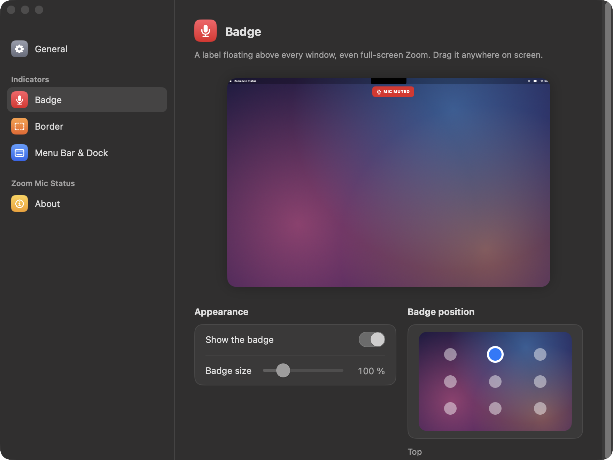
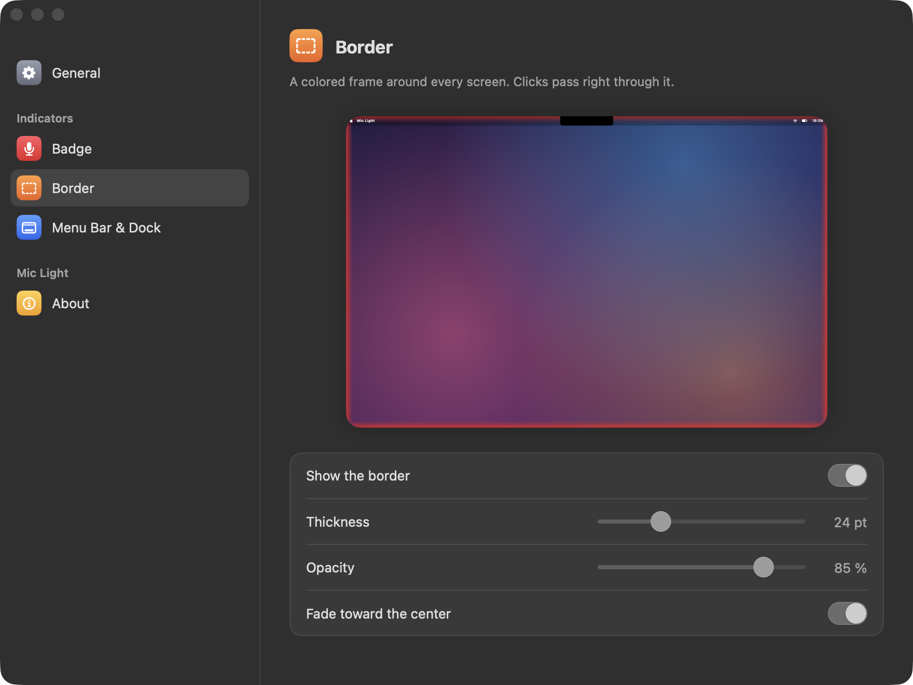

<p align="center">
  
</p>

<h1 align="center">Mic Light</h1>

<p align="center"><i>for Zoom</i></p>

<p align="center">
  Know at a glance whether Zoom can hear you.<br>
  Red when muted, green when live, out of the way when no meeting is running.
</p>

<p align="center">
  <a href="https://github.com/jerefrer/mic-light/releases/latest/download/MicLight.dmg"><b>Download for macOS</b></a>
  ·
  <a href="https://jerefrer.github.io/mic-light/">Website</a>
  ·
  macOS 15+ · signed &amp; notarized · updates itself
</p>

<p align="center">
  
</p>

## Four ways to see it

Turn on any combination:

| Indicator | What it shows |
|-----------|---------------|
| **Floating badge** | "MIC MUTED" / "MIC LIVE" above every window, even full-screen Zoom. Snap it to one of nine positions or drag it anywhere; size from 50 to 300 %. |
| **Screen border** | A red or green frame around every screen, fading toward the center. Clicks pass through it. Its corners follow your display: rounded at the top on notched MacBooks. |
| **Menu bar icon** | A colored mic, alone or with a label. |
| **Dock icon** | The app icon turns red or green. |

Outside meetings, the badge and border disappear and the icons turn grey.

<p align="center">
  
  
</p>

The settings preview every change live, on your real screen and on a miniature
of your own desktop.

## Install

1. [Download the DMG](https://github.com/jerefrer/mic-light/releases/latest/download/MicLight.dmg) and drag *Mic Light* to Applications.
2. Open it, choose **Grant Accessibility Access…** in its menu, and enable *Mic Light* in System Settings → Privacy & Security → Accessibility.

It then updates itself: it checks for a new version once a day, or on demand
with **Check for Updates…**.

## Private by design

Zoom has no public API for the desktop app's mute state, so Mic Light
reads what Zoom shows through the macOS Accessibility API: the **Meeting → Mute
audio / Unmute audio** menu and your own participant tile. It never clicks,
types or sends anything to Zoom, and nothing leaves your Mac.

## How it works

The app reads the title of Zoom's mute menu item: a menu offering to *unmute*
means the mic is muted. The titles are loaded from every localization inside
`zoom.us.app`, so detection works whatever language Zoom is in.

Zoom refreshes that menu only about once per second. Participant tiles change
immediately ("Name, Computer audio muted, Video off"), so the app learns which
tile is yours from the one that follows the menu over two toggles, then reads
it first: updates land 0–80 ms after Zoom. The menu stays the authority; if the
tile disagrees with it for more than 1.5 s, the app trusts the menu and learns
again. When your tile is off screen (speaker view, self view hidden), it falls
back to the menu.

Polling runs every 100 ms during a meeting and every 1.5 s otherwise, and only
the Meeting menu is searched: walking Zoom's other menus costs it noticeable
time.

## Development

Requires macOS 15 and the Xcode command line tools (Swift 6).

```sh
swift test                      # unit tests (detection and settings logic)
scripts/build-app.sh            # builds build/Mic Light.app
scripts/build-app.sh --install  # also copies it to ~/Applications
```

The detection and settings logic lives in `ZoomMicStatusCore` (no AppKit, unit
tested); `ZoomMicStatus` holds the AppKit windows, the SwiftUI settings and the
accessibility adapter. The app is signed with the Developer ID when it is in
the keychain, ad hoc otherwise; the version comes from the `VERSION` file.

```sh
"build/Mic Light.app/Contents/MacOS/ZoomMicStatus" --print-status
```

prints the detected status once (`mic(muted)`, `mic(live)`, `idle` or
`needsPermission`) without opening any window; the terminal running it needs
Accessibility access.

```sh
.build/debug/ZoomMicStatus --render-showcase "$PWD/docs/images"
```

re-renders the README and website images with the app's own views, over a
generated backdrop. Each image is a real window, captured, so they flash on
screen while rendering.

### Releasing

```sh
scripts/release.sh 0.2.0
```

Requires a clean working tree, the Developer ID certificate, the
`imprint-notarize` notarytool profile (`NOTARY_PROFILE` overrides it) and the
Sparkle private key in the login keychain (account `zoom-mic-status`). The
script builds the app, packs it in a DMG that Apple notarizes, signs the DMG
for Sparkle, writes `appcast.xml`, commits and tags the version, pushes, and
publishes a GitHub release with both files. Installed copies read
`releases/latest/download/appcast.xml`, so the newest release is always the
feed, and `releases/latest/download/MicLight.dmg` always downloads it.

---

Made by [Jérémy Frère](https://frerejeremy.me) · [Sponsor this work](https://github.com/sponsors/jerefrer) ·
also by Jérémy: [Headcount](https://jerefrer.github.io/headcount/), attendance reports for Zoom webinars.

Mic Light is not affiliated with Zoom. Zoom is a trademark of Zoom
Communications, Inc.
